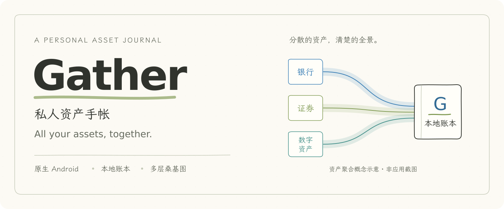
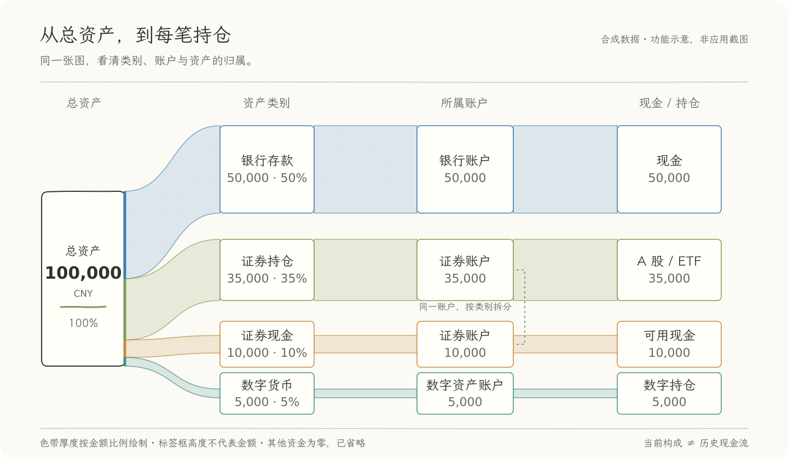

# Gather

**把值得关注的资产，放在一起。**

Android 原生的个人资产工具。把银行余额、证券可用现金、A 股 / ETF 和数字货币持仓汇总在本机，用手帐风格的图表看清资产分布与每日变化。



<p align="center">
  <a href="https://github.com/wqq977wqq977-source/Gather/releases/latest"></a>
  
  <a href="LICENSE"></a>
</p>

<p align="center">
  <a href="https://github.com/wqq977wqq977-source/Gather/releases/latest"><strong>下载 APK</strong></a> ·
  <a href="#开始使用">开始使用</a> ·
  <a href="docs/GUIDE.md">使用指南</a> ·
  <a href="docs/BUILD.md">构建说明</a> ·
  <a href="https://github.com/wqq977wqq977-source/Gather/issues">反馈问题</a>
</p>

## 一份账本，看清几个问题

| 你想知道 | Gather 的做法 |
| --- | --- |
| **我的资产一共有多少？** | 分开记录账户现金与持仓市值，再汇总为总资产。 |
| **钱分布在哪些账户和资产里？** | 环图看当前占比，多层桑基图展开类别、账户和具体持仓。 |
| **这段时间发生了什么变化？** | 按北京时间保留每日快照，查看近 7 天、近 30 天或全部已有记录。 |
| **想先体验，不想填自己的数据？** | 隔离的示例账本提供 90 天合成历史，始终标明示例，不写入本人资产。 |
| **如何带走自己的账本？** | 导出带密码的 AES-GCM 加密备份，在本机恢复。 |

### 从总资产，一路看到每份持仓



*上图是合成数据的功能示意，非应用截图。桑基图展示当前资产构成，不表示历史现金流；示例中「其他资金」为零，因此省略。*

按类别查看时，同屏展开 **总资产 → 类别 → 账户 → 现金／持仓**；按账户查看时，直接连接账户与其资产。支持放大、平移、节点选择和归属路径高亮，点选后可读精确金额与占比。隐藏金额时，整张资产图形和比例也会隐藏。

同一个证券账户可以出现在「证券持仓」和「证券现金」两条分支下，每处只计算对应部分，不会重复计入总资产。

### 同一本手帐，两种用笔

**彩铅手帐**使用暖纸和彩色笔触，**蓝墨手帐**使用冷纸与蓝色墨水。两种风格共享布局、离线手写字体与原生操作，跟随系统深浅色；目前共用一套深色配色。

在「设置与数据 → 界面风格」切换。汇总金额也可切换为 CNY / USD，美元显示使用带来源与日期的参考汇率。

## 开始使用

### 1. 安装

打开 **[最新 Release](https://github.com/wqq977wqq977-source/Gather/releases/latest)**，在 Assets 中下载 `.apk`，按 Android 提示允许该来源安装。最低要求为 **Android 8.0 / API 26**，界面目前为中文。

当前发布版本为 **0.7.1**，更新与验证范围见 [发布记录](docs/releases/0.7.1.md)。Release 同时提供 SHA-256 校验文件。原名「归拢」的同签名版本可覆盖升级，升级前建议导出加密备份。

### 2. 先体验，或建立自己的账本

首次打开可点「**先看看示例**」，也可在「设置与数据 → 预览示例」进入。退出示例后再开始录入：

1. 添加银行、证券、数字资产或其他资金账户，填入现金余额。
2. 在对应账户添加持仓，填写代码／币种、数量和单位成本。
3. 等待行情更新，在「统计 → 桑基图」查看分布；买卖后自行更新现金、数量与成本。

> **证券账户只填可用现金。** 例如现金 10,000 元、持仓市值 5,000 元，应分别录入，合计为 15,000 元。不要把券商显示的账户总资产再次填入现金；新增持仓也不会自动扣减现金。

### 3. 定期备份

在「设置与数据 → 导出加密备份」设置密码，保存 `.guilong` 文件。恢复前先备份现有账本：恢复会在确认后替换当前数据，忘记密码无法恢复。卸载或清除应用数据会删除本机账本。

## 支持范围

| 项目 | 当前支持 |
| --- | --- |
| 资金账户 | 银行、证券、数字资产、其他资金；12 种账户图标选项，含自动 |
| 股票与基金 | 人民币 A 股、场内 ETF；腾讯行情快照 |
| 数字货币 | BTC、ETH、SOL、BNB、XRP、DOGE、USDT、USDC；CoinGecko 人民币快照，数量最多 8 位小数 |
| 显示币种 | CNY / USD；Frankfurter 参考汇率或手动填写 |
| 数据保存 | 本机账本、每日快照、密码保护的导出备份 |

### 读数前，了解这些口径

- **总资产 = 全部账户现金 + 持仓市值。** 每日资产变化包含资金流入流出和手动调整，**不等于投资收益**。
- **账本始终以 CNY 保存。** USD 只是显示折算，历史美元曲线也使用当前参考汇率。
- **行情是参考快照。** 股票涨跌使用较昨收变化，数字货币使用 24 小时变化；断网保留上次报价，无有效报价时按录入成本估值。
- **账户与持仓由你维护。** 不连接银行、券商或钱包，不同步成交或执行交易；手续费、分红、拆并股及已实现收益需自行维护。

更多说明见 [计算口径与行情](docs/GUIDE.md#计算口径与行情)。

## 数据留在本机

账本保存在应用私有目录，禁用系统自动云备份，无登录和云端账本服务。**本机账本未额外加密，目前没有应用锁**；密码加密保护的是导出的备份文件。

联网用于查询行情和参考汇率，不上传账户名称、余额或持仓数量。服务提供方仍能看到网络请求及所查询的证券／币种。完整说明见 [隐私与备份](docs/GUIDE.md#隐私与备份)。

## 开发

原生 **Java / Android Views / Canvas**，无第三方运行时依赖。

| 工具 | 版本 |
| --- | --- |
| JDK | 17 |
| Android SDK / Build Tools | 35 / 35.0.0 |
| Android Gradle Plugin / Gradle Wrapper | 8.9.2 / 8.11.1 |
| 最低 / 目标 Android API | 26 / 35 |

```bash
git clone https://github.com/wqq977wqq977-source/Gather.git
cd Gather

# 配置 JDK 17、Android SDK 35 与 Build Tools 35.0.0
./gradlew :app:assembleDebug
```

标准 Gradle debug 构建及领域检查已在隔离的 JDK 17 / Android SDK 35 下通过，并接入 GitHub CI；发行包使用本地离线构建器及私有签名身份。工具链配置、领域测试与模拟器入口见 [构建与验证](docs/BUILD.md)。其他人构建的 APK 签名不同，无法覆盖官方同包名安装。

[0.7.1 发布验证](docs/releases/0.7.1.md)记录了已有检查及范围；完整 UI 回归、真机、TalkBack、厂商后台策略和长期行情可用性仍需进一步验证。

## 参与与文档

欢迎在 [Issues](https://github.com/wqq977wqq977-source/Gather/issues) 提供可复现问题，或提交聚焦单一问题的 Pull Request。复现时请使用合成数据，勿上传真实账本、备份密码、签名文件或带个人资产的截图。

| 文档 | 内容 |
| --- | --- |
| [使用指南](docs/GUIDE.md) | 录入方法、计算边界、行情、备份与常见问题 |
| [构建说明](docs/BUILD.md) | 开发环境、离线构建器、测试与专用模拟器 |
| [发布记录](docs/releases/0.7.1.md) | 0.7.1 更新及实际验证范围 |
| [字体来源](docs/FONTS.md) | 内置字体、原始来源与授权信息 |

## 许可证与致谢

原创代码采用 [MIT License](LICENSE)。内置字体分别遵循 **SIL Open Font License 1.1**，完整许可证随字体打包；Gradle Wrapper 保留上游 Apache-2.0 声明。市场数据与第三方服务遵循各自条款，代码许可证不授予其数据权利。

